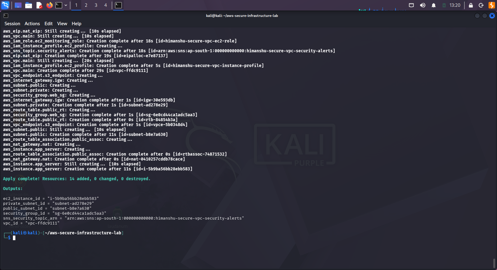
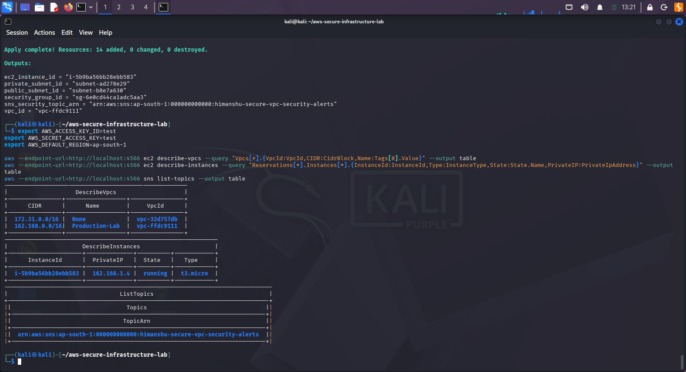
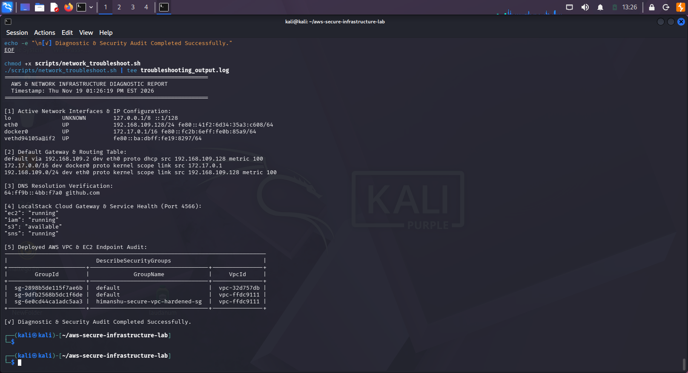

# AWS Secure Infrastructure & Monitoring Lab (Terraform IaC)

A modular, security-hardened AWS cloud infrastructure and automated network diagnostics lab built with **Terraform**, **AWS CLI**, **LocalStack**, and **Bash**.

## Architecture & Security Controls

* **Custom Isolated VPC (162.168.0.0/16):** Multi-AZ segmentation separating the Public Tier (162.168.1.0/24 in ap-south-1a) from the Private Tier (162.168.2.0/24 in ap-south-1b).
* **Controlled Ingress & Egress:** Internet Gateway + Public Route Table for external HTTPS traffic, paired with an Elastic IP and NAT Gateway for outbound private subnet updates.
* **Private AWS Backbone Access:** VPC Gateway Endpoint for Amazon S3 (com.amazonaws.ap-south-1.s3) keeps storage traffic off the public internet.
* **Least-Privilege Security Group:** Allows only HTTPS (443/tcp) publicly and restricts SSH (22/tcp) strictly to internal VPC CIDR (162.168.0.0/16).
* **Compute & Identity Hardening:** EC2 instance (t3.micro) enforcing **IMDSv2** (http_tokens = required) and attached IAM Role/Instance Profile.
* **Security Alerting & Diagnostics:** Dedicated Amazon SNS security alert topic (himanshu-secure-vpc-security-alerts) and automated Linux diagnostic script (scripts/network_troubleshoot.sh).

---

## Step-by-Step Deployment & Verification Workflow

### 1. Local Cloud Environment Setup
* `docker run -d --name localstack-main -p 127.0.0.1:4566:4566 localstack/localstack:3.8.1` -> Starts local AWS cloud emulator on port 4566.
* `curl -s http://localhost:4566/_localstack/health` -> Verifies core cloud services are available and running.

### 2. Modular Terraform Provisioning
* `terraform init` -> Initializes working directory and downloads hashicorp/aws (~> 5.0) provider plugin.
* `terraform validate` -> Audits HCL syntax across provider.tf, variables.tf, main.tf, and outputs.tf.
* `terraform apply -auto-approve` -> Provisions all **14 cloud infrastructure resources**.

### 3. AWS CLI State Verification
* `aws --endpoint-url=http://localhost:4566 ec2 describe-vpcs` -> Confirms deployment of 162.168.0.0/16 custom VPC.
* `aws --endpoint-url=http://localhost:4566 ec2 describe-instances` -> Verifies hardened t3.micro EC2 node is running.
* `aws --endpoint-url=http://localhost:4566 sns list-topics` -> Confirms creation of SNS security alert topic ARN.

### 4. Automated Network & Endpoint Diagnostics
* `chmod +x scripts/network_troubleshoot.sh` -> Grants execute permissions to Bash diagnostic script.
* `./scripts/network_troubleshoot.sh | tee troubleshooting_output.log` -> Audits network interfaces, routing tables, DNS, LocalStack health, and Security Groups.

