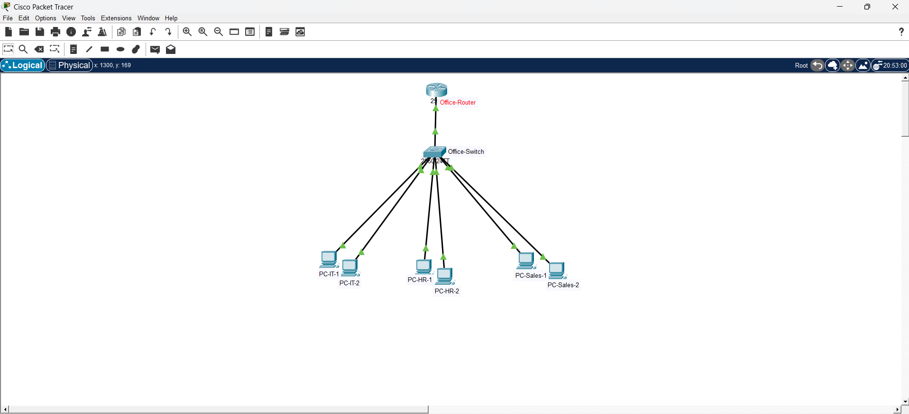
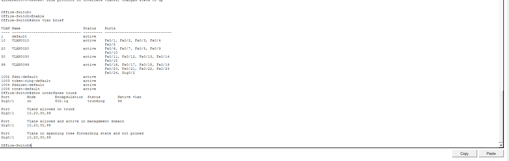

# Small Office Network Design & Inter-VLAN Routing Lab

## Project Overview
Designed and deployed a segmented enterprise small-office network in **Cisco Packet Tracer** utilizing **IEEE 802.1Q VLAN segmentation**, **Router-on-a-Stick (ROAS)** inter-VLAN routing, automated **DHCP address allocation**, and **Layer 2 Port Security**. The architecture isolates departmental broadcast domains while maintaining controlled inter-departmental communication.

---

## Network Architecture & Topology

### Hardware & Simulation Stack
- **Router:** Cisco 2911 Integrated Services Router (`Office-Router`)
- **Switch:** Cisco Catalyst 2960-24TT (`Office-Switch`)
- **Endpoints:** 6 Departmental Workstations (`PC-IT-1/2`, `PC-HR-1/2`, `PC-Sales-1/2`)
- **Tool:** Cisco Packet Tracer

---

## IP Addressing & VLAN Allocation Plan (VLSM)
Base Network: `192.168.10.0/24` subnetted across four functional VLANs:

| VLAN ID | VLAN Name | Department / Role | Network / CIDR | Subnet Mask | Default Gateway | DHCP Pool Range | Switch Ports |
| :--- | :--- | :--- | :--- | :--- | :--- | :--- | :--- |
| **10** | `IT_ADMIN` | IT & Administration | `192.168.10.0/26` | `255.255.255.192` | `192.168.10.1` | `.11 – .62` | `Fa0/1 – Fa0/5` |
| **20** | `HR_OPERATIONS` | HR & Operations | `192.168.10.64/26` | `255.255.255.192` | `192.168.10.65` | `.75 – .126` | `Fa0/6 – Fa0/10` |
| **30** | `SALES_SUPPORT` | Sales & Support | `192.168.10.128/26` | `255.255.255.192` | `192.168.10.129` | `.139 – .190` | `Fa0/11 – Fa0/15` |
| **99** | `MANAGEMENT_NATIVE` | Native VLAN & Switch SVI | `192.168.10.192/27` | `255.255.255.224` | `192.168.10.193` | Static (`SVI: .194`) | `Gig0/1 (Trunk)` |

---

## Key Security & Engineering Implementations
1. **802.1Q Trunking & Native VLAN Hardening:** Configured `GigabitEthernet 0/1` as a dedicated trunk link carrying only explicitly permitted VLANs (`10, 20, 30, 99`) and migrated the native VLAN from default `VLAN 1` to `VLAN 99` to mitigate VLAN hopping risks.
2. **Switch Port Security & PortFast:** Enabled `switchport port-security` (maximum 2 MAC addresses, `restrict` violation mode) and `spanning-tree portfast` on all active departmental access ports.
3. **Unused Port Shutdown:** Assigned all unused interfaces (`Fa0/16–24`, `Gig0/2`) to `VLAN 99` and placed them in `administratively down` (`shutdown`) state.
4. **Centralized DHCP Services:** Configured isolated DHCP pools with gateway/static IP exclusions (`excluded-address`) on `Office-Router` sub-interfaces (`Gig0/0.10`, `0/0.20`, `0/0.30`).

---

## Verification & Testing Evidence

### 1. VLAN Database & 802.1Q Trunk Status
Verified active departmental port mappings (`show vlan brief`) and active 802.1Q trunk forwarding (`show interfaces trunk`):

### 2. Automated DHCP Lease & End-to-End Inter-VLAN Connectivity
Verified dynamic IP assignment via `ipconfig` on `PC-IT-1` (`192.168.10.11`) and successful ICMP echo replies across `VLAN 20` (`192.168.10.75`) and `VLAN 30` (`192.168.10.139`):

---

## Repository Artifacts
- **Packet Tracer Lab File:** [`small-office-vlan-lab.pkt`](small-office-vlan-lab.pkt)
- **Router Configuration:** [`configs/office-router-running-config.txt`](configs/office-router-running-config.txt)
- **Switch Configuration:** [`configs/office-switch-running-config.txt`](configs/office-switch-running-config.txt)